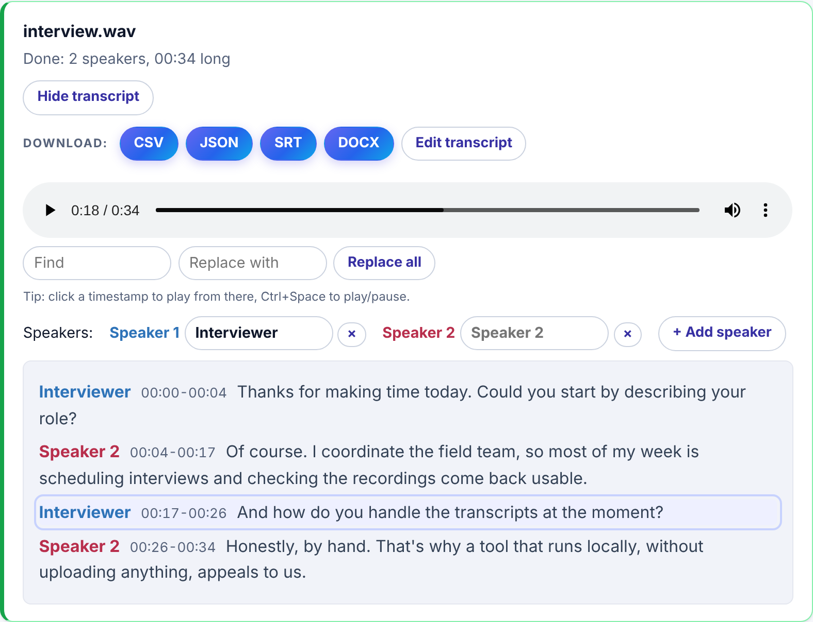
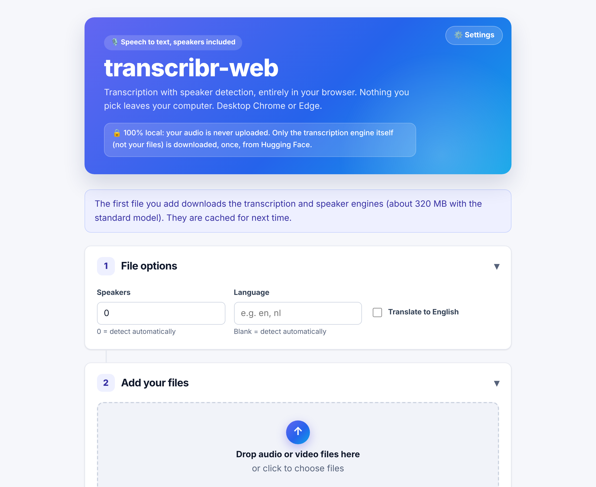
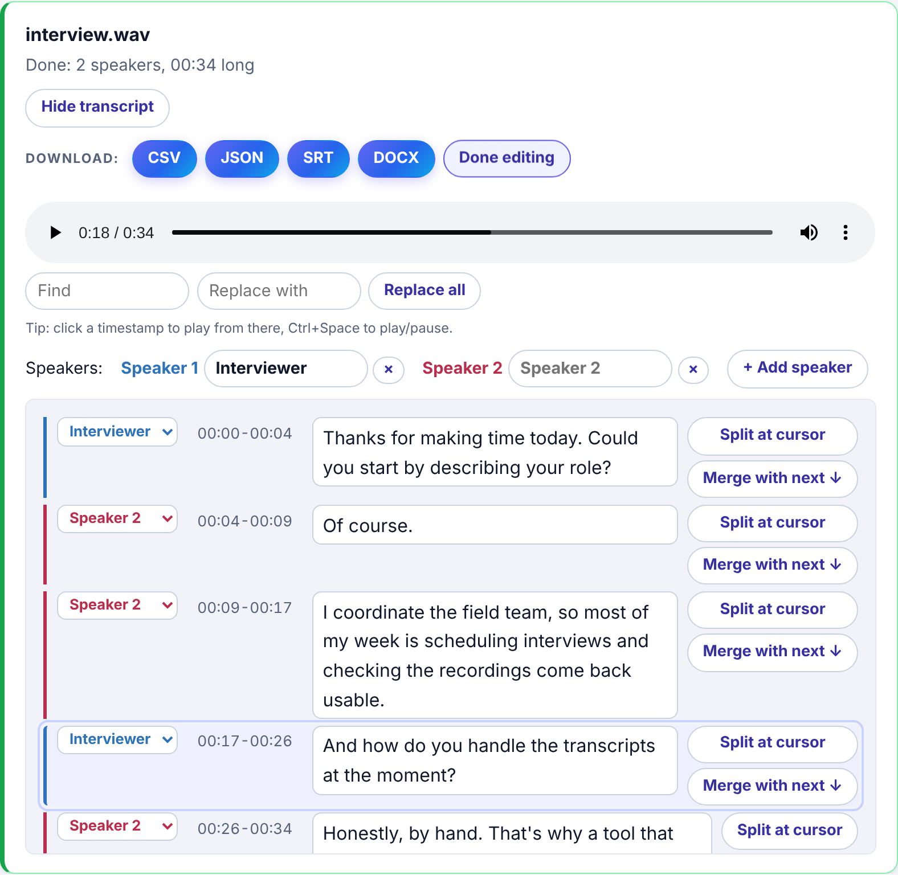
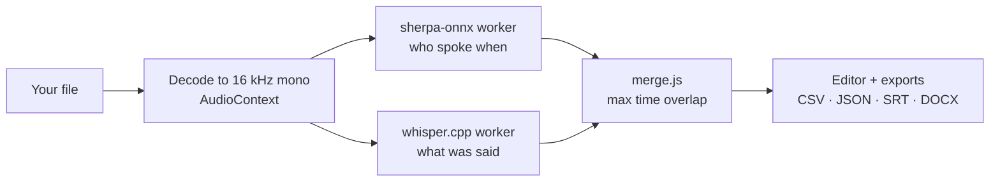

<div align="center">

# transcribr-web

**Transcription and speaker diarization that runs entirely in your browser.**
No server, no install, no upload. Your audio never leaves your machine.

[](https://github.com/PeterSlijkhuis/transcribr-web/actions/workflows/deploy-pages.yml)
[](https://peterslijkhuis.github.io/transcribr-web/)

### [→ Try it live](https://peterslijkhuis.github.io/transcribr-web/)

<sub>Desktop Chrome or Edge</sub>

<br />

<picture>
  <source media="(prefers-color-scheme: dark)" srcset="docs/images/transcript-dark.png" />
  
</picture>

</div>

## Contents

- [What it does](#what-it-does)
- [How to use it](#how-to-use-it)
- [Privacy](#privacy)
- [Choosing a model](#choosing-a-model)
- [FAQ](#faq)
- [For developers](#for-developers)
- [Credits](#credits)

## What it does

Drop in an audio or video file and get back a transcript with speaker labels,
ready to export. [Whisper](https://github.com/ggml-org/whisper.cpp) and a
speaker-diarization pipeline ([sherpa-onnx](https://github.com/k2-fsa/sherpa-onnx))
are compiled to WebAssembly and run on your own CPU, inside the browser tab.

| | |
| --- | --- |
| 🎙️ **Transcription** | Whisper in three sizes, with optional translation to English |
| 👥 **Speaker detection** | Finds who spoke when, automatically or for a fixed number of speakers |
| ▶️ **Listen along** | Built-in player; click any timestamp to play from there, and the line being played is highlighted |
| ✏️ **Editing** | Rename speakers, reassign a sentence, fix wording, split or merge lines, find & replace |
| 📄 **Export** | CSV, JSON, SRT subtitles and Word (DOCX) |
| 📦 **Batch queue** | Drop several files at once; they run one after another |
| 🔒 **Private** | No backend, no analytics, no upload |
| ⚡ **Cached** | Engines download once, then load from the browser cache |

## How to use it

The page walks you through three numbered steps.

**1. File options.** Optionally set the language and the number of
speakers. Leaving them blank or at 0 means "detect automatically". The
model and light/dark appearance live under **⚙️ Settings** at the top right,
and both are remembered in your browser.



**2. Add your files.** Drag audio or video onto the drop zone, or click to
choose. Anything your browser can play works (MP3, WAV, M4A, MP4, WebM, ...).

**3. Review and download.** Each file shows live progress, then its
transcript with a player for the original recording. Click a timestamp to
hear that line (the line being played is highlighted), and press
**Ctrl+Space** to play or pause, even while typing. Rename "Speaker 1" to
"Interviewer", fix a misheard name everywhere with **Replace all**, hit
**Edit transcript** to correct individual lines, and download in the format
you need. Edits apply to every export immediately; there is no separate
save step.



## Privacy

**Your audio and video files are never uploaded anywhere: not to GitHub,
not to us, not to anyone.** transcribr-web is a static page with no backend
and no analytics.

You don't have to take that on trust. The app makes exactly three kinds of
network request, all one-directional *downloads*, and your files appear in
none of them:

1. `engines/manifest.json`, a small same-origin file listing engine URLs.
2. The WASM engines and the Whisper model you pick, downloaded once from
   Hugging Face and cached by the browser.
3. `coi-serviceworker.js` re-issues the page's own requests with extra
   response headers (needed for `SharedArrayBuffer`). It never adds a new
   destination or new data.

Your audio is decoded locally (`AudioContext`) and handed to the engines
only as in-memory `postMessage` data between your tab and its workers.
Check it yourself: open DevTools → Network while transcribing, or read
`app.js` and `engines/*.js`.

## Choosing a model

Pick the model under **⚙️ Settings**; the app shows a hardware recommendation next to the picker. Rule of thumb: start with
**Standard**; drop to **Fast** on an older laptop, step up to **Accurate**
for hard audio (accents, noise, crosstalk) if you can wait.

| Tier | Whisper model | Parameters | Download | Good on | Speed |
| --- | --- | --- | --- | --- | --- |
| Fast | `tiny`, 5-bit (`ggml-tiny-q5_1`) | 39 M | 32 MB | Any laptop from the last decade | Real-time or faster on one core |
| Standard (default) | `small`, 5-bit (`ggml-small-q5_1`) | 244 M | 190 MB | A 4+ core CPU from the last ~5 years | Roughly real-time with 4 threads |
| Accurate | `medium`, 5-bit (`ggml-medium-q5_0`) | 769 M | 514 MB | An 8+ core CPU | Several times slower than real-time |

### What actually differs between the tiers

All three are the same OpenAI Whisper architecture, trained on the same
data, in different sizes. A bigger model has more capacity, so it:

- makes fewer word errors, especially on accents, background noise,
  overlapping speech, names and jargon;
- is better at languages other than English, where `tiny` degrades fastest;
- punctuates and capitalizes more reliably;
- hallucinates less (inventing or repeating text during silence or music).

The cost is roughly linear in size: about 6x more compute and memory from
Fast to Standard, and another 3x from Standard to Accurate. Everything runs
on your CPU, so that cost is your wait time.

### Why these models

- **Multilingual, not English-only.** Whisper also ships `.en` variants
  that are slightly better on English, but they can't transcribe other
  languages or translate, so the app uses the multilingual models.
- **5-bit quantized.** The weights are compressed from 16-bit to about
  5-bit, cutting downloads and memory roughly 3x for a small accuracy cost.
  In a browser tab, where memory is capped and everything downloads first,
  that trade is worth it.
- **Standard is `small`, not `base`.** The app used `base` early on;
  `small` is clearly more accurate and still runs around real-time on a
  normal laptop, so it became the default.
- **No `large` tier (yet).** `large-v3` has about 1.5 B parameters, twice
  `medium`. On a CPU in WebAssembly it would be far slower than real-time
  for most people, and it pushes against the 4 GB memory the engine can
  address. The faster `large-v3-turbo` is a plausible future tier but
  hasn't been tested here.
- **Models come straight from the source.** All three are the official
  whisper.cpp conversions on Hugging Face
  ([`ggerganov/whisper.cpp`](https://huggingface.co/ggerganov/whisper.cpp)),
  not re-hosted copies. The URLs are in `engines/manifest.json`.

### Speaker detection models

Speaker detection is the same for every tier and runs before
transcription:

| Model | Job |
| --- | --- |
| [pyannote segmentation-3.0](https://huggingface.co/pyannote/segmentation-3.0) | Finds where speech is and where the speaker changes |
| [NVIDIA NeMo TitaNet-large](https://catalog.ngc.nvidia.com/orgs/nvidia/teams/nemo/models/titanet_large) | Turns each speech chunk into a "voiceprint" so chunks from the same person cluster together |

Both are the ONNX exports from the sherpa-onnx project, bundled into the
diarization engine (about 100 MB). A first run with the Standard model
therefore downloads roughly 320 MB in total. After that it is cached.

## FAQ

<details>
<summary><strong>Why does it run in the browser instead of on a server?</strong></summary>

Privacy and cost. A server means uploading your recordings to someone else's
machine, which is a non-starter for interviews, medical or legal audio, or
anything confidential. It also means someone pays for GPUs. Running Whisper
as WebAssembly on your own CPU removes both problems: there is nothing to
upload to and nothing to host except static files. The tradeoff is speed;
see below.
</details>

<details>
<summary><strong>Is this WhisperX?</strong></summary>

No. WhisperX is a Python pipeline that needs a GPU server. transcribr-web
uses the same idea (Whisper for words, a separate diarization model for
speakers, then a merge by time overlap) but built from
[whisper.cpp](https://github.com/ggml-org/whisper.cpp) and
[sherpa-onnx](https://github.com/k2-fsa/sherpa-onnx), which compile to
WebAssembly. Diarization uses pyannote segmentation plus TitaNet speaker
embeddings.
</details>

<details>
<summary><strong>Why isn't there a "large" model?</strong></summary>

See [Why these models](#why-these-models). Short version: on a CPU inside a
browser tab it would be very slow for most machines and close to the
engine's memory limit.
</details>

<details>
<summary><strong>Which browsers work?</strong></summary>

Current desktop **Chrome** and **Edge**. The engines need WebAssembly SIMD
and `SharedArrayBuffer` (cross-origin isolation); the page checks both on
load and tells you if your browser falls short. Firefox and Safari may work
but aren't tested. Phones and tablets usually don't have the memory.
</details>

<details>
<summary><strong>How long will my file take?</strong></summary>

It depends on your CPU and the model. On a typical modern laptop with the
Standard model, expect roughly the length of the recording. Fast is quicker,
Accurate can take a 10-minute file 10 to 20 minutes. Speaker detection adds
a bit on top. There's a small game to play while you wait.
</details>

<details>
<summary><strong>Can it use my GPU?</strong></summary>

Yes, for Fast and Standard: tick **Use the GPU** under ⚙️ Settings. It runs
Whisper through WebGPU ([Transformers.js](https://github.com/huggingface/transformers.js)
with the ONNX exports of the same models), so it needs a recent Chrome or
Edge. On one tested laptop, Standard went from 1.9x to 5.4x faster than real
time. The first GPU run downloads its own copy of the model. CUDA and ROCm
can't be used from a web page; WebGPU is the browser's route to the GPU.
Speaker detection still runs on the CPU.
</details>

<details>
<summary><strong>Is there a file size or length limit?</strong></summary>

No hard limit, but everything happens in one browser tab's memory. The app
warns before processing recordings longer than about an hour, since those
can be slow or run out of memory. Splitting very long recordings helps.
</details>

<details>
<summary><strong>Does it work offline?</strong></summary>

After the first run, mostly yes: engines and models are kept in the
browser's Cache Storage. You still need to load the page itself, and
picking a model you haven't used before downloads it once.
</details>

<details>
<summary><strong>Are my edits saved?</strong></summary>

Only in the open tab. Nothing is stored on a server (there isn't one), so
download your transcript before closing the page. The page asks for
confirmation if you try to close or reload it while finished transcripts
are open.
</details>

<details>
<summary><strong>Which languages are supported?</strong></summary>

Everything Whisper supports (about 100 languages). Leave the language blank
to auto-detect, or enter a code like `en` or `nl` to force one. Tick
**Translate to English** to get an English transcript of non-English audio.
</details>

<details>
<summary><strong>The speakers are wrong. What can I do?</strong></summary>

If you know how many people speak, set **Speakers** to that number before
adding the file; that's the biggest accuracy win. Afterwards, use **Edit
transcript** to reassign individual lines, or remove a speaker to fold its
lines into another.
</details>

<details>
<summary><strong>How do I clear the downloaded engines?</strong></summary>

Clear site data for the page in your browser settings (or DevTools →
Application → Storage → Clear site data). Old engine versions are cleaned
up automatically when the app updates.
</details>

## For developers

### Run it locally

```sh
npm install
node test/serve.mjs        # http://localhost:8090/
```

Any static server works if it sends
`Cross-Origin-Opener-Policy: same-origin` and
`Cross-Origin-Embedder-Policy: require-corp` (needed for WASM threads). On
hosts that can't set headers, like GitHub Pages, `coi-serviceworker.js` adds
them client-side. Opening `index.html` via `file://` does not work.

### Tests

```sh
npm test          # unit tests: merge logic and exporters
npm run e2e       # real engines + fixture audio in headless Chromium
```

`.github/workflows/deploy-pages.yml` runs both on every pull request and on
`master`, then deploys to GitHub Pages from `master`. To redeploy without a
new commit, run it manually (Actions → Test and deploy → Run workflow).

### How it works



- One Web Worker per engine. Emscripten's runtime exposes globals
  (`Module`, `HEAPU8`, ...), so two engines can't share a worker.
- `engines/whisper-worker.js` runs whisper.cpp and watches stderr for
  `whisper_print_timings: total time` to know a run finished.
- `engines/sherpa-worker.js` runs sherpa-onnx diarization at 16 kHz.
- `merge.js` gives each transcript segment to the speaker that overlaps it
  most, splits segments that straddle a speaker change, and numbers
  speakers by first appearance.
- The editor changes the same rows every exporter reads, so edits show up
  in every export with no save step.
- `export/` writes CSV, JSON, SRT, and a hand-built minimal DOCX. The
  CSV/JSON schema matches a companion desktop app, so output from either
  feeds the same analysis pipeline.

See `docs/superpowers/specs/` for the full design.

### Layout

| Path | What's there |
| --- | --- |
| `index.html`, `styles.css`, `app.js` | The page, file queue and rendering |
| `engines/` | The two worker wrappers, cached-fetch helper, engine manifest |
| `merge.js`, `shared.js` | Speaker/transcript merge logic, formatting helpers |
| `export/` | CSV, JSON, SRT, DOCX writers |
| `engines-build/` | CI-only scripts that build and publish the WASM engines |
| `test/` | Unit tests, the Playwright e2e check, a local dev server |
| `docs/images/` | README screenshots |

## Credits

Built on [whisper.cpp](https://github.com/ggml-org/whisper.cpp) (MIT) and
[sherpa-onnx](https://github.com/k2-fsa/sherpa-onnx) (Apache-2.0), with
cross-origin isolation via [coi-serviceworker](https://github.com/gzuidhof/coi-serviceworker)
(MIT). Full attribution in `NOTICE.md`.
